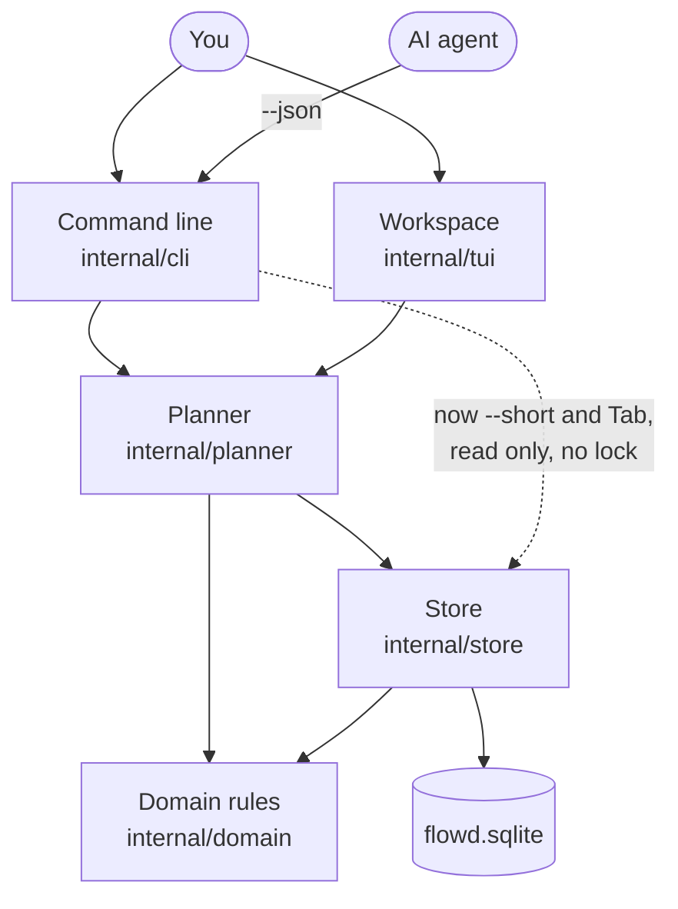

# Architecture

How the parts fit together.

## Overall shape

- One Go program for macOS and Linux, with one SQLite file. No server and no network.
- The command line and the terminal workspace use exactly the same operations.

Every change goes down the solid arrows: the planner checks it against the domain rules, and the
store saves it in one transaction. The dotted arrow is the quick read for the status line and tab
completion, which never writes.

| Package | Job |
| --- | --- |
| `cmd/flowd` | Starts the program |
| `internal/domain` | Items, status changes, time and rules, with no file access |
| `internal/store` | SQLite tables, transactions and backups |
| `internal/planner` | The operations every frontend shares |
| `internal/cli` | Commands, their output, completion and the pickers |
| `internal/tui` | The terminal workspace |
| `skills` | The Agent Skill, built into the program |
| `scripts` | License notices and the repository's own checks, never part of the program |

Packages only depend on the ones below them. Item rules live in the domain. Rules about when
something may change, like which days can be planned and how much of a day is left, live in the
planner, so the command line and the workspace can never disagree.

## Saving

- Every change is one transaction, written to disk before it returns. A change to an item and its
  event are saved together.
- Work and paused time are never stored. They are worked out from the events.
- Before a transaction commits, the day is checked against the domain rules and every item's
  history is replayed. A change that breaks a rule never reaches the disk. The one change accepted
  after a day ended is marking an incomplete item done, with `corrected_at` set.
- A change names the revision of the item it was read at. If the item changed since, it is refused.
- Each visible item has a `position`, numbered 1, 2, 3 with no gaps. A new order names every item
  once and renumbers the day in two passes, negative first, so no two items ever share a number.
  The order is not part of any item's history.
- Closing a day at midnight happens the next time the file is opened, so it works even if flowd
  was not running.
- One process uses the file at a time, through a `.lock` file next to it. The database and its
  folder are private to you, and a file others can read is refused.
- Every open checks the file read only first: its schema version and SQLite's integrity check. On
  two years of daily use this takes about 15 ms. An empty, damaged or foreign file is refused and
  left as it was.

## Upgrading the file

- The schema has a version. Version 2 added the item a copy came from, version 3 each item's place
  in its day, and version 4 when an item was marked done later. An older file goes through every
  version in one upgrade.
- flowd writes a backup first, then upgrades in one transaction. If anything fails, the file stays
  as it was. An older flowd refuses the upgraded file, so going back means restoring the backup.

## Shared operations

- Every operation opens the file, reads the clock once, closes any ended day, does its work and
  closes the file. Nothing holds the database while a person is thinking.
- Today comes from this computer's timezone. A new day is saved with it and keeps it.
- Starting an item pauses the running one in the same save, at the same instant.
- Every change ends Refused, Confirmed or Unconfirmed. Unconfirmed means it is unknown whether the
  save landed, and flowd asks you to check with `flowd list` instead of guessing.
- Which items a command fits is decided once in the domain and shared by completion, the pickers
  and the checks before a change.

## Reading without the lock

- `flowd now --short` and tab completion may run every second, so they open the file read only and
  without the lock. SQLite's WAL mode gives them the last saved state while another flowd saves.
- They never create the file, never close a day and never print an error.
- The workspace reads again only when a stat fingerprint of the file changes, after its own change,
  at midnight, and every thirty seconds. An empty WAL counts as no WAL, so these readers never look
  like a change.

## Text and errors

- One policy in the domain decides which characters a title may hold, checked on add and edit. A
  repository test fails if a hidden character appears in the source or the docs.
- Every error has a code, a sentence and a hint. People see the sentence and the hint, and scripts
  get all three as JSON with `--json`.

## Backup and doctor

- `flowd backup` writes a consistent `.bak` copy next to the database, replacing the old one only
  once the new one is on disk.
- `flowd doctor` checks the file, its permissions, schema and integrity, and changes nothing.
- `flowd doctor --repair` checks the backup, moves the current files into a private recovery folder
  and copies the backup in their place. `flowd reset` moves them the same way when you ask for a backup, or deletes them
  when you do not, and leaves the next open to start a new file.

## Distribution

- Each release has a static archive per system with checksums, and signed build provenance.
- `install.sh` checks the checksum and, when the GitHub CLI is signed in, the provenance. It runs
  the new program once before putting it in place, and puts the old one back if anything fails. It
  never edits shell files or touches your data.
- release-please cuts releases from the commit history. CI builds every release, installs it with
  the real installer and only then publishes it.
